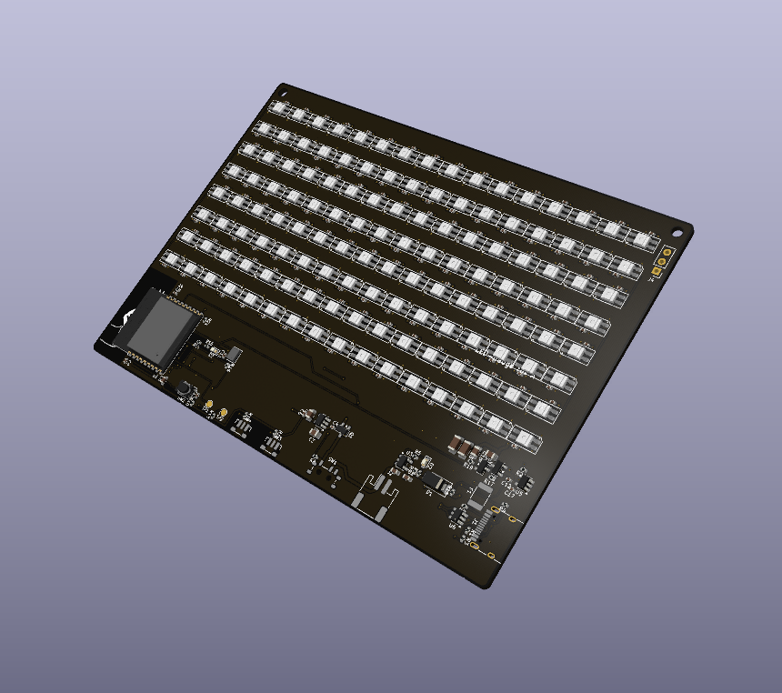
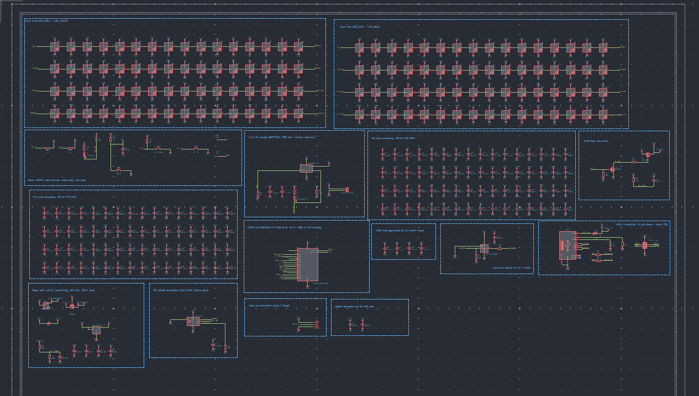
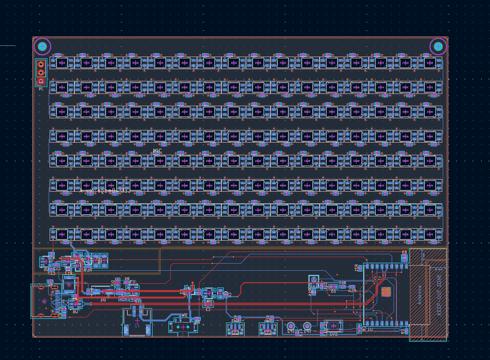

<h1 align="center">
 

 
zyn
 
</h1>

<h3 align="center">

A 16 by 8 RGB LED matrix on an ESP32-C3, with a mic, two buttons and USB-C charging!

</h3>

| Back render |
| --- |
|  |

## Specs

| | |
| --- | --- |
| Board | 127 x 92 mm, 4 layers |
| Pixels | 128 x SK6812 mini-e, 16 columns by 8 rows, on the bottom side |
| MCU | ESP32-C3-WROOM-02 (4 MB flash, wifi, BLE 5, PCB antenna) |
| Mic | ICS-43434 on I2S (wired, not used by the firmware yet) |
| Charger | MCP73831, 1S LiPo, 500 mA, JST PH connector |
| Regulator | AP2112K-3.3 for the logic |
| Matrix supply | VLED, from VSYS through a p-channel load switch, enabled by IO4 |
| Inputs | BTN_A (boot), BTN_B, reset |
| Status | red charge LED (D2), blue LED on IO8 (D3) |

## How it works

USB-C comes in through a 2A polyfuse (F1). The charger takes VBUS and charges the LiPo, and VSYS feeds the 3.3 V regulator and the matrix switch. The matrix only gets power when IO4 is high, so the board can switch the LEDs off when it's idle.

The data line runs from IO10 through an SN74LV1T125 level shifter (powered from VLED, so the pixels get a logic level they can read) and a 33 ohm series resistor, into the first pixel's DIN. The 128 pixels are chained DIN to DOUT in a snake: row 0 runs left to right, row 1 runs right to left, and so on.

## Pinout

| GPIO | Module pin | Net | Used for |
| --- | --- | --- | --- |
| IO10 | 10 | LED_DATA | pixel data (through the level shifter) |
| IO4 | 3 | LED_EN | matrix power on/off |
| IO9 | 8 | BTN_A | boot button, cycles effects |
| GPIO20 (RXD) | 11 | BTN_B | user button, cycles brightness |
| IO8 | 7 | IO8_LED | blue status LED (D3) |
| IO5 / IO6 / IO7 | 4 / 5 / 6 | MIC_WS / MIC_SCK / MIC_SD | mic (I2S, not used yet) |
| IO18 / IO19 | 13 / 14 | USB_D- / USB_D+ | native USB |
| IO3 / IO1 | 15 / 17 | CC2_SENSE / CC1_SENSE | USB-C orientation sense |
| IO0 | 18 | VBAT_SENSE | battery voltage sense |
| IO2 | 16 | IO2 | spare |

## Firmware

The firmware is in [firmware/zyn/zyn.ino](firmware/zyn/zyn.ino). It was written with help from AI. The pins were checked against the netlist and the module pin layout, but this exact file has not been run on the board yet, so test it with the matrix at low brightness first.

### Setup

1. Arduino IDE, Preferences, add the ESP32 board manager URL `https://espressif.github.io/arduino-esp32/package_esp32_index.json`
2. Boards Manager: install "esp32" by Espressif
3. Library Manager: install "FastLED"
4. Board: "ESP32C3 Dev Module", and turn on "USB CDC on boot" if you want serial output
5. Hold BOOT while plugging in the first time, then upload `zyn.ino`

### Controls

| Button | Action |
| --- | --- |
| BTN_A (boot) | cycle effects: rainbow, scan line, sparkle, breathe |
| BTN_B | cycle brightness: low, medium, high |

The status LED blinks once a second while the firmware is running.

### Notes

- The matrix runs from VSYS, so on battery the pixels see 3.0 to 4.2 V. The brightness is capped at 50 and the power limit is set to 400 mA in the code. Check the pixels at battery voltage before you go higher.
- The chain order and the pixel grid come from the netlist and the position file, so every pixel is in the right place for the effects.
- The mic is wired but the firmware doesn't read it yet.

## Schematic

| Schematic overview |
| --- |
|  |

## PCB

| Full board |
| --- |
|  |

## How can you get one?

All the files you need are in the `production` folder. Upload `production/zyn.zip` to any PCB fab, and use `production/zyn_bom.csv` and the position files for assembly. The full build log is in [JOURNAL.md](JOURNAL.md).

## BOM

Full part list with LCSC part numbers is in [BOM.csv](BOM.csv) and [production/zyn_bom.csv](production/zyn_bom.csv).

| Designator | Footprint | Qty | Value | LCSC part | Unit price (INR) | Line total (INR) |
| --- | --- | --- | --- | --- | --- | --- |
| C1, C2 | 0603 | 2 | 4.7u/10V | CL10A475KO8NNNC | 10 | 20 |
| C10, C4, C6 | 0402 | 3 | 1u/10V | CL05A105KP5NNNC | 2 | 6 |
| C101 to C228 | 0402 | 132 | 100n/16V | CL05B104KO5NNNC | 1 | 132 |
| C12 | 0402 | 1 | 47n/16V | CL05B473KO5NNNC | 2 | 2 |
| C13, C14 | 1206 | 2 | 47u/10V | CL31A476MPHNNNE | 25 | 50 |
| C15, C16, C3, C5 | 0805 | 4 | 22u/10V | CL21A226MPQNNNE | 12 | 48 |
| C8 | 0603 | 1 | 10u/10V | CL10A106KP8NNNC | 5 | 5 |
| D1 | D_SMA | 1 | SS34 | SS34 (3 A / 40 V) | 10 | 10 |
| D2 | 0603 | 1 | RED (charging) | KT-0603R | 3 | 3 |
| D3 | 0603 | 1 | BLUE (IO8) | KT-0603B | 3 | 3 |
| D101 to D228 | SK6812MINI-E reverse mount | 128 | SK6812MINI-E | SK6812MINI-E | 20 | 2560 |
| F1 | 1812 | 1 | 2A | Bourns MF-MSMF200-2 | 15 | 15 |
| J1 | USB-C HRO TYPE-C-31-M-12 | 1 | USB-C | HRO TYPE-C-31-M-12 | 25 | 25 |
| J2 | JST PH S2B-PH-SM4-TB | 1 | LiPo 1S (JST-PH) | JST S2B-PH-SM4-TB | 10 | 10 |
| Q1, Q2 | SOT-23 | 2 | AO3401A | AO3401A | 15 | 30 |
| Q3 | SOT-23 | 1 | 2N7002 | 2N7002 | 3 | 3 |
| R1, R2 | 0402 | 2 | 5.1k | RC0402FR-075K1L | 1 | 2 |
| R10, R11, R12, R13, R14, R17, R3, R4 | 0402 | 8 | 10k | RC0402FR-0710KL | 1 | 8 |
| R15, R6 | 0402 | 2 | 1k | RC0402FR-071KL | 1 | 2 |
| R16, R18, R19, R21, R7, R8, R9 | 0402 | 7 | 100k | RC0402FR-07100KL | 1 | 7 |
| R20 | 0402 | 1 | 33R | RC0402FR-0733RL | 1 | 1 |
| R5 | 0402 | 1 | 2k | RC0402FR-072KL | 1 | 1 |
| SW1 | SW_SPDT_Shouhan_MSK12C02 | 1 | POWER (slide) | Shouhan MSK12C02 | 25 | 25 |
| SW2 | SW_SPST_PTS810 | 1 | RESET | C&K PTS810SJM250SMTRLFS | 10 | 10 |
| SW3, SW4 | SW_Push Alps SKRTLAE010 | 2 | BTN_A / BTN_B | Alps SKRTLAE010 | 15 | 30 |
| U1 | ESP32-C3-WROOM-02 | 1 | ESP32-C3-WROOM-02 | ESP32-C3-WROOM-02-N4 | 180 | 180 |
| U2 | ICS-43434 | 1 | ICS-43434 | ICS-43434 | 150 | 150 |
| U3 | SOT-23-5 | 1 | MCP73831-2-OT | MCP73831T-2ACI/OT | 25 | 25 |
| U4 | SOT-23-5 | 1 | AP2112K-3.3 | AP2112K-3.3TRG1 | 12 | 12 |
| U5 | SOT-23-5 | 1 | SN74LV1T125DBV | SN74LV1T125DBVR | 15 | 15 |
| U6 | SOT-23-6 | 1 | USBLC6-2SC6 | USBLC6-2SC6 | 10 | 10 |
| **Total** | | | | | | **3400** |
